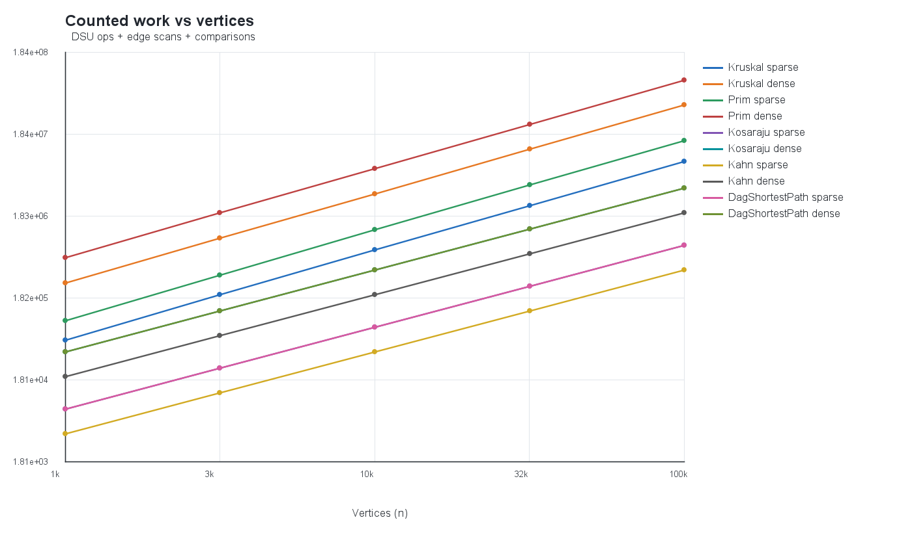
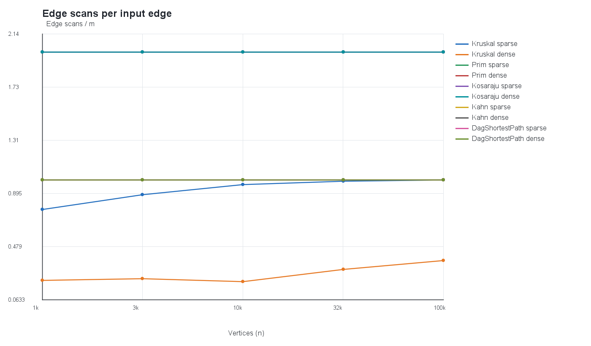
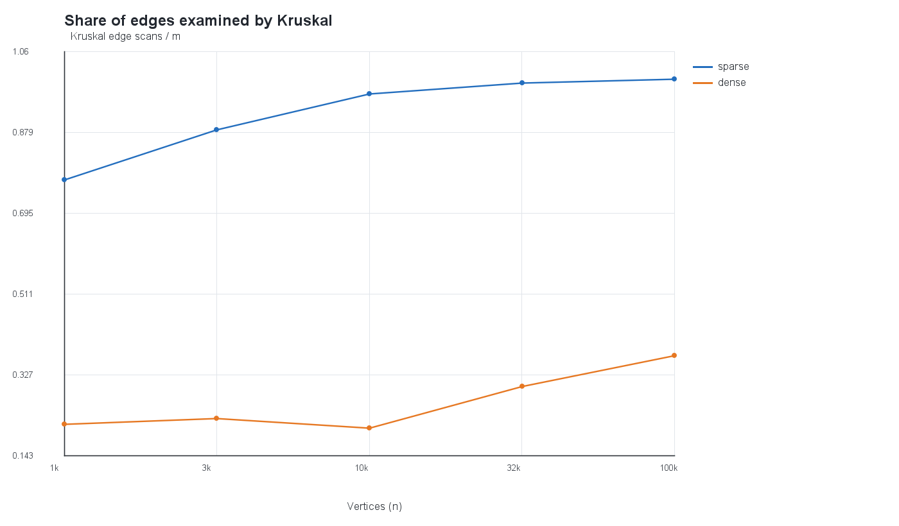

# Assignment 3 Report: Graph Algorithms

## Implementation and results

The project uses one adjacency-list `Graph` type for directed and undirected inputs. Each edge has an integer weight; parallel edges, loops, isolated vertices, and disconnected graphs are supported. DSU uses rank and path compression, Kruskal sorts the edge list, and Prim grows a forest with a priority queue. Kosaraju and Kahn use iterative traversal; DAG shortest paths relax edges in topological order from every zero-in-degree vertex, which is equivalent to adding a zero-weight virtual source. The benchmark uses a fresh `Random(42)` for each generated graph, reports the median of five runs, and counts operations inside the algorithms.

The benchmark checked each MST pair, each topological order, and all reference outputs before writing CSV rows. All ten generated graph pairs reproduced the supplied answers:

| n / m | MST weight | SCC count | DAG distance sum |
|---:|---:|---:|---:|
| 1,000 / 4,000 | 147,970 | 27 | 396,274 |
| 1,000 / 20,000 | 30,363 | 1 | 252,411 |
| 3,162 / 12,648 | 468,911 | 137 | 1,271,911 |
| 3,162 / 63,240 | 97,589 | 1 | 723,157 |
| 10,000 / 40,000 | 1,486,139 | 373 | 3,941,828 |
| 10,000 / 200,000 | 309,550 | 1 | 2,381,342 |
| 31,623 / 126,492 | 4,715,515 | 1,188 | 12,551,891 |
| 31,623 / 632,460 | 968,517 | 1 | 7,376,612 |
| 100,000 / 400,000 | 15,012,094 | 3,923 | 40,096,539 |
| 100,000 / 2,000,000 | 3,056,681 | 1 | 23,512,087 |

## Complexity and counter checks

| Algorithm | Time | Extra space | Why |
|---|---|---|---|
| DSU `find` / `union` | Amortized O(α(V)) per operation | O(V) | Rank limits tree height and path compression flattens paths. |
| Kruskal | O(E log E + E α(V)) | O(V + E) | Sort all edges, then inspect candidates with DSU. |
| Prim | O((V + E) log E) | O(V + E) | Each adjacency entry is scanned and candidate edges use a binary heap. |
| Kosaraju | O(V + E) | O(V + E) | Two iterative DFS passes plus the reversed graph. |
| Kahn | O(V + E) | O(V) | Build in-degrees, queue zero-in-degree vertices, and decrement outgoing neighbors. |
| DAG shortest paths | O(V + E) | O(V) | One pass over the topological order and outgoing edges; the provided order is reused. |

The ratios stay bounded as the graph size grows. Kruskal performs 0.8914–0.9383 weight comparisons per `m log₂(m)` and 2.4036–2.9718 DSU operations per candidate edge scanned; the latter is a small constant because each candidate causes two finds, with successful unions adding two finds and one union count. Its candidate scan examines 20.68%–99.97% of the input edges, depending on density and size. Prim scans exactly `2m` adjacency entries on these connected undirected inputs and performs 1.8262–1.9458 comparisons per `m log₂(m)`. Kosaraju scans exactly `2m`; `edgeScans/(V+E)` ranges from 1.6000 to 1.9048. Kahn and DAG relaxation each scan exactly `m`; each has `edgeScans/(V+E)` from 0.8000 to 0.9524. The traversal ratios approach their limiting constants as `E` grows relative to `V`.

The maximum explicit DFS stack observed by Kosaraju on the 100,000-vertex directed graphs was 59,394 for the sparse graph and 91,920 for the dense graph. This depth is stored in the CSV; no JVM recursion is used. Kahn and DAG relaxation have `max_depth = 0` because they do not use an explicit DFS stack.

## Correctness arguments

**Cut property.** A cut divides the vertices into two nonempty sides, and any spanning tree must contain an edge crossing that cut. If an edge is the lightest edge crossing a cut, replacing a heavier crossing edge in an MST with it cannot increase the tree’s weight. Thus the lightest crossing edge is safe to add while preserving the possibility of reaching an MST. Kruskal repeatedly joins two current components with a light edge and skips edges whose endpoints are already connected. Prim uses the cut between its current tree and the remaining vertices and chooses the lightest edge crossing it from a priority queue. Repeating either safe choice builds a minimum spanning tree for a connected graph, or a minimum spanning forest when the input is disconnected. Equal-weight ties may produce different edges, but the total weight remains minimum.

**One-pass DAG relaxation.** Consider the vertices in a topological order, so every incoming edge of a vertex comes from an earlier vertex. Each zero-in-degree vertex starts with distance zero, representing an edge from the virtual source. Assume all earlier vertices already have their shortest distances; when the current vertex is reached, relaxing its incoming edges has already considered every possible final edge of any path to it. Therefore its stored distance is shortest before its outgoing edges are relaxed. Induction over the order proves the distances are correct for every vertex after one pass. Negative weights do not invalidate this reasoning because a DAG has no directed cycle that could revisit a vertex and lower an earlier distance. A general graph can contain a negative cycle, in which case a shortest path may not exist, and even without one this topological order is unavailable.

## Which algorithm when?

| Situation | Choice | Reason |
|---|---|---|
| Sparse undirected graph stored as an edge list | Kruskal | Sorting is natural for an edge list, and DSU quickly skips cycle-forming edges. |
| Undirected graph already stored as adjacency lists | Prim | It grows from a chosen start and uses neighbors directly; restart at each unvisited vertex for a forest. |
| Very dense undirected graph with an adjacency matrix | Prim with the O(V²) matrix version | Scanning a row per added vertex avoids sorting all E edges and avoids a heap. This project’s required adjacency-list priority-queue version instead has O(E log E) heap work. |
| Cycles may exist in a directed dependency graph | Kahn to detect a cycle; Kosaraju to locate cyclic groups | Kahn refuses to return a partial order as valid; Kosaraju identifies strongly connected components. |
| Directed acyclic graph, including negative edge weights | Topological order then DAG relaxation | One O(V+E) pass is enough and negative weights are safe in an acyclic graph. |
| General graph with cycles and nonnegative edge weights | Dijkstra | Its nonnegative-weight condition makes greedy finalization safe; it is not used for negative weights. |

## Plots and timing

The log-log slope of `edgeScans` against `n` is 1.0000 for Prim, Kosaraju, Kahn, and DAG relaxation in both densities. Kruskal’s measured scan slopes are 1.0549 on sparse graphs and 1.1194 on dense graphs, slightly steeper because more candidates are examined as the graph grows; sorting’s additional `E log E` work appears in the comparison counter. The operation plot combines `dsu_ops + edge_scans + comparisons` to show that sorting and heap comparisons contribute substantially to MST work.

Across the five-run medians, recorded times ranged from 0.400 ms to 2,055.996 ms. At 100,000 vertices and two million edges, Kruskal’s median was 844.984 ms and Prim’s was 2,055.996 ms on this run. Small-graph timings are dominated by JVM startup and background noise, and all timings vary with hardware, JDK, and load. The counters are the reproducible evidence: the linear traversals scan exactly one or two edges per input edge, while Kruskal and Prim spend additional work comparing weights.
